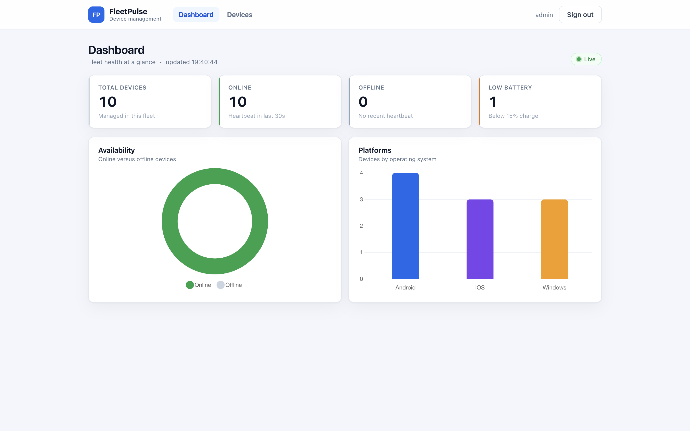
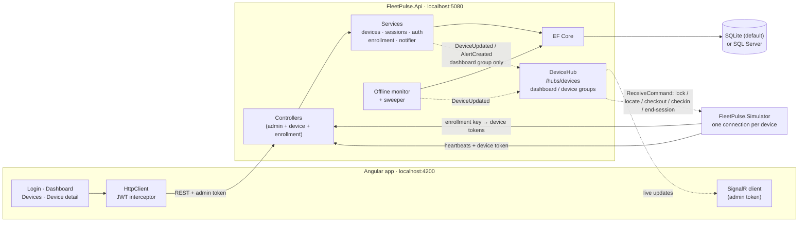

# FleetPulse

A small, full-stack **mobile device management (MDM)** demo: a live fleet dashboard, searchable device inventory, remote lock/locate actions, shared-device check-out for frontline workers, and a device simulator that keeps the data moving.

Built as a portfolio project — deliberately small, runnable with three commands by default (SQLite, no cloud services), and with an optional SQL Server path for a more enterprise-like deployment.



   

---

## Overview

FleetPulse tracks 10 sample devices (Android, iOS, Windows). A console simulator enrolls each device, sends heartbeats every 5 seconds with a draining battery and drifting GPS coordinates, and listens for commands over SignalR. The API stores the state, raises low-battery alerts, marks silent devices offline, tracks shared-device sessions, and pushes every change to the Angular dashboard.

## Live demo

- **App:** <https://your-netlify-site.netlify.app> _(placeholder — update after deploying)_
- **API:** <https://fleetpulse-api-e31c.onrender.com>
- **Health check:** `/health`

The API runs on Render's free tier, so **the first load can take about a minute** while the instance wakes from sleep. Demo mode generates heartbeats inside the API (no simulator process needed), and the SQLite file lives in the container's `/tmp`, so **data resets whenever the instance restarts**.

### Deployment

The API ships as a Docker image (`Dockerfile` at the repo root); point Render at the repository with the Docker runtime, health check path `/health`, and these environment variables:

| Variable | Value |
| --- | --- |
| `ASPNETCORE_ENVIRONMENT` | `Production` |
| `Demo__Enabled` | `true` |
| `ConnectionStrings__Default` | `Data Source=/tmp/fleetpulse.db` |
| `Jwt__Key` | `<random 32+ character string>` |
| `Enrollment__Key` | `<random string>` |
| `Cors__AllowedOrigins__0` | `https://<your-netlify-site>.netlify.app` |

On Netlify, set the base directory to `src/fleetpulse-web` (it picks up `netlify.toml` for the build, publish directory and SPA redirect), and keep `apiBaseUrl` in `src/environments/environment.prod.ts` in sync with the Render URL before deploying.

## Features

- **JWT authentication with roles** — a demo admin signs into the Angular app (route guard + HTTP interceptor); each device gets its own long-lived token from enrollment
- **Device enrollment** — a device presents the shared enrollment key and receives a 30-day token with a `deviceId` claim; heartbeats are rejected unless the token's device matches the payload
- **Live dashboard** — total / online / offline / low-battery cards, a doughnut chart for availability, a bar chart for platform breakdown, all updating in real time over SignalR
- **Device inventory** — paged (Previous/Next), debounced search by name/platform/OS, status filter, colour-coded battery gauge, last-seen timestamps, and a "checked out to" column
- **Device detail** — full device facts, Leaflet map of the last reported position, recent alerts, **Lock** / **Locate** actions with toast confirmations
- **Shared-device sessions** — check a device out to a worker, check it back in, or force-end a session as an admin (recorded as `admin:<username>`); the latest 20 sessions are listed on the device page
- **Remote commands** delivered to the target device over SignalR, logged by the simulator, and **acknowledged back** to the dashboard (toasts say "confirmed by device")
- **Automatic offline detection** — a background service sweeps every 5 seconds and marks devices with no heartbeat for 30 seconds as Offline
- **Low-battery alerts** created when a device crosses below 15%, without duplicating on every heartbeat
- **xUnit tests** — 26 tests covering heartbeat/alert logic, the offline sweep, pagination, enrollment and heartbeat authorization, and sessions
- **Two database providers** — SQLite by default; SQL Server 2022 with `docker compose up -d`
- Responsive layout, loading and error states throughout

## Tech stack

| Layer | Technology |
| --- | --- |
| API | ASP.NET Core 8 Web API, C#, layered (Controllers → Services → EF Core) |
| Data | Entity Framework Core 8 + SQLite by default (file created and seeded on first run); SQL Server 2022 optional via Docker |
| Real time | SignalR (`/hubs/devices`) |
| Auth | JWT bearer tokens with `Admin` / `Device` roles; one hardcoded admin, one token per enrolled device |
| Frontend | Angular 19, standalone components, Router, HttpClient, RxJS signals |
| Charts | ng2-charts + Chart.js 4 |
| Map | Leaflet + OpenStreetMap tiles |
| Simulator | .NET 8 console app with the SignalR .NET client |
| Tests | xUnit + SQLite in-memory + `WebApplicationFactory` integration tests |

## Architecture



**Flow in one line:** the simulator enrolls each device → posts heartbeats with that device's token → the API persists them and broadcasts `DeviceUpdated` to the dashboard group → connected admin clients refetch the summary and re-render cards and charts.

## Project structure

```
FleetPulse/
├── FleetPulse.sln
├── docker-compose.yml          optional SQL Server 2022
├── README.md
├── docs/                       screenshots
└── src/
    ├── FleetPulse.Api/
    │   ├── Auth/               JWT, admin and enrollment options, token service
    │   ├── Controllers/        Auth, Enrollment, Devices, Heartbeat, Dashboard
    │   ├── Data/               DbContext + first-run seed (10 devices)
    │   ├── DTOs/
    │   ├── Entities/           Device, Alert, DeviceSession
    │   ├── Hubs/               DeviceHub
    │   ├── Services/           DeviceService, DeviceSessionService, EnrollmentService,
    │   │                       DeviceNotifier, DeviceOfflineSweeper, DeviceOfflineMonitor
    │   ├── appsettings.json
    │   └── appsettings.SqlServer.json
    ├── FleetPulse.Api.Tests/   service tests + enrollment/authorization integration tests
    ├── FleetPulse.Simulator/
    │   ├── Program.cs          enrollment, per-device hub connections, heartbeat loop
    │   ├── ApiClient.cs
    │   └── SimulatedDevice.cs
    └── fleetpulse-web/
        └── src/app/
            ├── core/           auth, services, models, guard, interceptor
            ├── pages/          login, dashboard, devices, device-detail
            └── shared/         battery indicator, map, toast
```

## Getting started

### Prerequisites

- [.NET 8 SDK](https://dotnet.microsoft.com/download/dotnet/8.0)
- Node.js **20.11+** (or 18.19+, or 22+) with npm

No database installation is needed — SQLite is created automatically. Docker is only required for the optional SQL Server setup.

> If `dotnet` is not on your `PATH`, run the commands below with its full path (for example `./.dotnet/dotnet run`).

### 1. Run the API

```bash
cd src/FleetPulse.Api
dotnet run
```

- API: <http://localhost:5080>
- Swagger UI: <http://localhost:5080/swagger>

On first start it creates `fleetpulse.db` and seeds 10 devices plus two sample alerts.

### 2. Run the simulator (new terminal)

```bash
cd src/FleetPulse.Simulator
dotnet run
```

It reads the device list with the shared enrollment key, enrolls every device, opens one SignalR connection per device, and then sends heartbeats every 5 seconds. It never uses the admin account.

Optional overrides:

```bash
dotnet run -- http://localhost:5080           # API URL as first argument
FLEETPULSE_API=http://localhost:5080 dotnet run
FLEETPULSE_ENROLLMENT_KEY=my-key dotnet run   # must match Enrollment:Key
```

### 3. Run the Angular app (new terminal)

```bash
cd src/fleetpulse-web
npm install
npm start
```

Open <http://localhost:4200>. The dev server is already configured for the API's CORS policy on port 5080.

### 4. Run with SQL Server (optional)

SQLite stays the default; no code changes are needed to switch.

```bash
# 1. start SQL Server 2022 (Docker Desktop must be running)
docker compose up -d

# 2. point the API at it (loads appsettings.SqlServer.json)
cd src/FleetPulse.Api
ASPNETCORE_ENVIRONMENT=SqlServer dotnet run
```

The first start creates the `FleetPulse` database, its schema and the seed data. The container password defaults to `FleetPulse!Passw0rd123`; override it with `MSSQL_SA_PASSWORD` and update the connection string to match.

To use SQL Server while keeping the Development environment (and Swagger), override with environment variables instead:

```bash
ASPNETCORE_ENVIRONMENT=Development \
Database__Provider=SqlServer \
ConnectionStrings__Default="Server=localhost,1433;Database=FleetPulse;User Id=sa;Password=FleetPulse!Passw0rd123;TrustServerCertificate=True" \
dotnet run
```

Reset the SQL Server database with `docker compose down -v` (removes the volume). Delete `src/FleetPulse.Api/fleetpulse.db*` to reset SQLite.

### 5. Run the tests

```bash
dotnet test
```

Tests run against an in-memory SQLite database and an in-process API, so they do not need SQL Server or the simulator.

## Demo login

| Username | Password |
| --- | --- |
| `admin` | `Admin@123` |

Credentials, the JWT signing key and the enrollment key in `src/FleetPulse.Api/appsettings.json` are **demo values only** and must be replaced for any real deployment. The SQL Server SA password in `docker-compose.yml` and `appsettings.SqlServer.json` is demo-only as well.

## API reference

Admin endpoints require an admin JWT (`Role=Admin`). Device endpoints require the token issued by enrollment (`Role=Device`), and the heartbeat is matched against the token's `deviceId` claim. Enrollment itself is protected by the shared enrollment key.

| Method | Endpoint | Description |
| --- | --- | --- |
| `POST` | `/api/auth/login` | Returns a JWT for the demo admin |
| `POST` | `/api/enrollment` | Device enrollment: `{ deviceId, enrollmentKey }` → device JWT (30 days). `401` for a wrong key, `404` for an unknown device |
| `GET` | `/api/enrollment/devices` | Device list for the simulator; requires the `X-Enrollment-Key` header instead of a JWT |
| `GET` | `/api/devices?search=&status=&page=1&pageSize=20` | Paged device list (`{ items, page, pageSize, totalCount }`, pageSize capped at 100); `search` matches name, platform or OS; `status` is `Online` / `Offline` |
| `GET` | `/api/devices/{id}` | Device details plus its 10 most recent alerts and current worker |
| `POST` | `/api/devices/heartbeat` | Device-only: updates battery, location and last-seen; creates a low-battery alert. `403` if the token's `deviceId` differs from the body |
| `POST` | `/api/devices/{id}/lock` | Marks the device locked and sends a lock command over SignalR |
| `POST` | `/api/devices/{id}/locate` | Sends a locate command over SignalR |
| `POST` | `/api/devices/{id}/checkout` | Body `{ workerName }`; starts a session, `409` if the device is already checked out |
| `POST` | `/api/devices/{id}/checkin` | Ends the active session as the worker (`409` if none) |
| `POST` | `/api/devices/{id}/force-end-session` | Ends the active session as `admin:<username>` and sends an `end-session` command |
| `GET` | `/api/devices/{id}/sessions` | Latest 20 sessions for the device |
| `GET` | `/api/dashboard/summary` | Totals, online/offline, low-battery count, platform breakdown |

Errors use standard status codes: `400` for validation failures, `401` for bad credentials or a missing/expired token, `403` for a valid token with the wrong role or a mismatched device, `404` for unknown devices, `409` for conflicting session operations.

### SignalR (`/hubs/devices`)

The hub requires authentication. Admin connections join the `dashboard` group and receive broadcasts; device connections join only their own `device-{id}` group.

| Direction | Message | Payload |
| --- | --- | --- |
| Server → dashboard | `DeviceUpdated` | Device DTO |
| Server → dashboard | `AlertCreated` | Alert DTO |
| Server → dashboard | `CommandAcknowledged` | `{ deviceId, command, acknowledgedAt }` |
| Server → device | `ReceiveCommand` | `{ deviceId, command: "lock" \| "unlock" \| "locate" \| "checkout" \| "checkin" \| "end-session", workerName? }` |
| Device → server | `RegisterDevice(deviceId)` | Joins `device-{id}`; only permitted when the device token's `deviceId` matches, otherwise the hub throws |
| Device → server | `AckCommand(deviceId, command)` | Confirms a command; the server records it and pushes `CommandAcknowledged` to the dashboard group |

## How it works

- **Enrollment and tokens** — devices prove themselves with the shared enrollment key and receive a 30-day token carrying `Role=Device` and a `deviceId` claim. Heartbeats must use that token and the body's `deviceId` must match the claim.
- **Hub authorization** — the hub is `[Authorize]`; `RegisterDevice` and `AckCommand` verify the same claim, and only admin connections are added to `dashboard`. Broadcasts go to that group, never to `Clients.All`.
- **Command acknowledgement** — the simulator calls `AckCommand` after it handles a command. The server logs it and broadcasts `CommandAcknowledged` to the dashboard, and the device detail page shows a "confirmed by device" toast for that device.
- **Offline detection** — `DeviceOfflineMonitor` runs every `Monitoring:ScanIntervalSeconds` (default 5s) and delegates to `DeviceOfflineSweeper`, which marks any `Online` device whose `LastSeen` is older than `Monitoring:OfflineThresholdSeconds` (default 30s) as `Offline` and broadcasts each change. Stop the simulator and the whole fleet goes offline within half a minute.
- **Low-battery alerts** — a heartbeat below 15% creates an alert only when the device was above the threshold on the previous heartbeat, so a sustained low battery doesn't flood the feed; it fires again after the device recovers and drops back below.
- **Shared sessions** — a device has at most one active session (`EndedAt` null). Check-out records who took it and when; check-in closes it as `worker`; force-end closes it as `admin:<username>` and sends `end-session` to the device. `currentWorker` is included in every device DTO.
- **Live dashboard** — hub events are throttled to one summary refetch per 1.2s, so ten devices heartbeating every 5s don't hammer the API. The "Live" badge reflects the actual hub connection state, and the client retries every 5s if the API restarts.
- **Simulator** — each device drains 0.2–0.8% per tick and drifts its coordinates slightly. A device that reaches 1% "recharges" to 100% so long demos keep producing data.
- **Demo mode** — when `Demo:Enabled=true`, `DemoSimulatorService` heartbeats every device directly through `IDeviceService` every 5s, and `IDeviceNotifier` is wrapped so commands are acknowledged about a second later. That keeps a hosted instance alive-looking without running the console simulator.

## Configuration

`src/FleetPulse.Api/appsettings.json`:

| Key | Default | Purpose |
| --- | --- | --- |
| `Database:Provider` | `Sqlite` | `Sqlite` or `SqlServer` (see `appsettings.SqlServer.json`) |
| `ConnectionStrings:Default` | `Data Source=fleetpulse.db` | SQLite file, or SQL Server connection string |
| `Jwt:Key` / `Issuer` / `Audience` / `ExpiryMinutes` | demo values / 480 | Admin token signing and validation |
| `Jwt:DeviceTokenExpiryDays` | `30` | Lifetime of an issued device token |
| `Enrollment:Key` | `fleetpulse-demo-enrollment-key` | Shared demo key devices use to enroll |
| `Admin:Username` / `Password` | `admin` / `Admin@123` | Demo account |
| `Cors:AllowedOrigins` | `http://localhost:4200` | Angular dev server |
| `Monitoring:OfflineThresholdSeconds` | `30` | Silence before a device is offline |
| `Monitoring:ScanIntervalSeconds` | `5` | Offline sweep frequency |
| `Demo:Enabled` | `false` | Simulate heartbeats in-process and auto-acknowledge commands (hosted demo) |

## Known limitations

This is a demo, not a production MDM. The important shortcuts:

- **Single hardcoded admin** — one username/password in `appsettings.json`, no user store, no password hashing, no refresh tokens.
- **No policies, app deployment or compliance** — no configuration profiles, app catalog, OS-update rules, encryption checks or compliant/non-compliant rollup.
- **Commands are simulated** — lock, locate, checkout and end-session are delivered to the simulator, which logs them and acknowledges receipt. The acknowledgement means "the device received it", not that the device enforced anything: there is no real device agent.
- **No database migrations** — schema is created with `EnsureCreated`, so schema changes require deleting the SQLite file (or the SQL Server database); a real deployment should use EF Core migrations.
- **Single server** — no SignalR backplane and no queue. All heartbeats, broadcasting and background sweeps run in one process, so it does not scale out horizontally as-is.
- **Shared enrollment secret** — one static key for all devices, no per-device secret, rotation or revocation. Device tokens are valid for 30 days and are held in the simulator's memory only.
- **Session concurrency** — the "one active session" rule is checked in application code, not by a database constraint, so two simultaneous check-outs could theoretically both succeed.

## Design decisions

- **Why SignalR** — the dashboard needs push updates from a .NET backend, and SignalR gives typed hubs, automatic reconnects and token auth over WebSockets without adding a broker for a demo.
- **Why a service layer** — controllers stay thin, business rules (alert thresholds, session rules, sweep logic) live behind interfaces, and those services are directly unit-testable with SQLite in-memory, a fake notifier and a fake clock.
- **Why `TimeProvider`** — offline thresholds, alert timestamps and session timestamps all depend on "now". Injecting `TimeProvider` makes those deterministic in tests instead of relying on sleeps.
- **Why broadcasts go only to the `dashboard` group** — device connections should never receive fleet-wide data. Group-scoped broadcasts keep device sockets limited to their own commands and prevent a device token from observing other devices.
- **How I would scale it** — put heartbeats on a queue (e.g. Azure Service Bus or RabbitMQ) with idempotent consumers, add a Redis backplane for SignalR so any API instance can push, move battery/location history to time-series storage (e.g. TimescaleDB), and scope every query by tenant/org id with per-tenant rate limits.

## Troubleshooting

- **`dotnet: command not found`** — install the .NET 8 SDK, or run the commands with the explicit path to your SDK (e.g. `./.dotnet/dotnet run`).
- **Login says the API is unreachable** — start the API on port 5080, or change `API_BASE_URL` in `src/fleetpulse-web/src/app/core/api.config.ts`.
- **CORS errors** — the Angular dev server must run on `http://localhost:4200`, or add your origin to `Cors:AllowedOrigins`.
- **`npm install` fails with `EACCES` on `~/.npm/_cacache`** — your npm cache has files npm can't rewrite. Use a project-local cache: `npm install --cache .npm-cache`.
- **The simulator logs an enrollment-key error** — `FLEETPULSE_ENROLLMENT_KEY` must match `Enrollment:Key` in `appsettings.json`.
- **An existing database is missing a table** (for example after a schema change) — `EnsureCreated` does not migrate. Delete `src/FleetPulse.Api/fleetpulse.db*` and restart the API, or drop and recreate the SQL Server database.
- **Everything is Offline** — the simulator isn't running, or it's pointed at the wrong API URL.

## Future improvements

- **Geofencing** — per-device fences with entry/exit alerts and a map overlay
- **Policies and compliance** — password rules, OS-version minimums, encryption status, with a compliant/non-compliant rollup
- **Roles and permissions** — admin vs. read-only operator, plus an audit trail for lock/locate/session actions
- **Remote actions beyond lock** — wipe, restart, push a message, install a profile, with device acknowledgements
- **Database migrations** — replace `EnsureCreated` with EF Core migrations for real deployments
- **Full-stack Compose** — API, web and simulator alongside the SQL Server container
- **Richer history** — battery/location time-series, per-device charts, alert acknowledgement
- **End-to-end tests** — Playwright coverage for login → dashboard → detail → lock → checkout → force end
