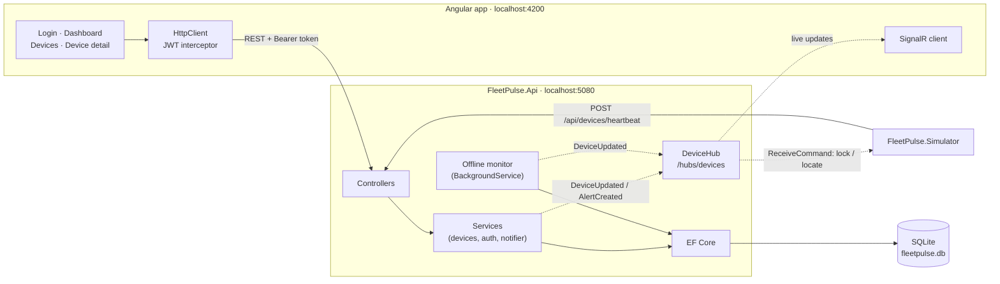

# FleetPulse

A small, full-stack **mobile device management (MDM)** demo: a live fleet dashboard, searchable device inventory, remote lock/locate actions, and a device simulator that keeps the data moving.

Built as a portfolio project — deliberately small, no external database or cloud services, and runnable with three commands.

  

---

## Overview

FleetPulse tracks 10 sample devices (Android, iOS, Windows). A console simulator sends heartbeats every 5 seconds with a draining battery and drifting GPS coordinates. The API stores the state in SQLite, raises low-battery alerts, marks silent devices offline, and pushes every change to the Angular dashboard over SignalR.

## Features

- **JWT authentication** with a single demo admin account, an Angular route guard and an HTTP interceptor
- **Live dashboard** — total / online / offline / low-battery cards, a doughnut chart for availability, a bar chart for platform breakdown, all updating in real time over SignalR
- **Device inventory** — search by name, platform or OS version, filter by status, colour-coded battery gauge, last-seen timestamps
- **Device detail** — full device facts, Leaflet map of the last reported position, recent alerts, and **Lock** / **Locate** actions with toast confirmations
- **Remote commands** delivered to the target device over SignalR and logged by the simulator
- **Automatic offline detection** — a background service sweeps every 5 seconds and marks devices with no heartbeat for 30 seconds as Offline
- **Low-battery alerts** created when a device crosses below 15%, without duplicating on every heartbeat
- **xUnit tests** covering heartbeat updates, alert thresholds, deduplication and command dispatch
- Responsive layout, loading and error states throughout

## Tech stack

| Layer | Technology |
| --- | --- |
| API | ASP.NET Core 8 Web API, C#, layered (Controllers → Services → EF Core) |
| Data | Entity Framework Core 8 + SQLite (file created and seeded on first run) |
| Real time | SignalR (`/hubs/devices`) |
| Auth | JWT bearer tokens, one hardcoded admin user |
| Frontend | Angular 19, standalone components, Router, HttpClient, RxJS signals |
| Charts | ng2-charts + Chart.js 4 |
| Map | Leaflet + OpenStreetMap tiles |
| Simulator | .NET 8 console app with the SignalR .NET client |
| Tests | xUnit + SQLite in-memory |

## Architecture



**Flow in one line:** the simulator posts heartbeats → the API persists them and broadcasts `DeviceUpdated` → connected Angular clients refetch the summary and re-render cards and charts.

## Project structure

```
FleetPulse/
├── FleetPulse.sln
├── README.md
└── src/
    ├── FleetPulse.Api/
    │   ├── Auth/            JWT options + token service
    │   ├── Controllers/     Auth, Devices, Dashboard
    │   ├── Data/            DbContext + first-run seed (10 devices)
    │   ├── DTOs/
    │   ├── Entities/        Device, Alert
    │   ├── Hubs/            DeviceHub
    │   ├── Services/        DeviceService, AuthService, DeviceNotifier, DeviceOfflineMonitor
    │   └── Program.cs
    ├── FleetPulse.Api.Tests/
    │   └── DeviceServiceTests.cs
    ├── FleetPulse.Simulator/
    │   ├── Program.cs       heartbeat loop + SignalR listener
    │   ├── ApiClient.cs
    │   └── SimulatedDevice.cs
    └── fleetpulse-web/
        └── src/app/
            ├── core/        auth, services, models, guard, interceptor
            ├── pages/       login, dashboard, devices, device-detail
            └── shared/      battery indicator, map, toast
```

## Getting started

### Prerequisites

- [.NET 8 SDK](https://dotnet.microsoft.com/download/dotnet/8.0)
- Node.js **20.11+** (or 18.19+, or 22+) with npm

No database installation is needed — SQLite is created automatically.

> If `dotnet` is not on your `PATH`, run the commands below with its full path (for example `./.dotnet/dotnet run`).

### 1. Run the API

```bash
cd src/FleetPulse.Api
dotnet run
```

- API: <http://localhost:5080>
- Swagger UI: <http://localhost:5080/swagger>

On first start it creates `fleetpulse.db` and seeds 10 devices plus two sample alerts.

### 2. Run the simulator (new terminal)

```bash
cd src/FleetPulse.Simulator
dotnet run
```

Optional: pass a different API URL as the first argument, or set `FLEETPULSE_API`.

```bash
dotnet run -- http://localhost:5080
```

It logs each heartbeat batch and prints incoming lock/locate commands.

### 3. Run the Angular app (new terminal)

```bash
cd src/fleetpulse-web
npm install
npm start
```

Open <http://localhost:4200>. The dev server is already configured for the API's CORS policy on port 5080.

### 4. Run the tests

```bash
dotnet test
```

## Demo login

| Username | Password |
| --- | --- |
| `admin` | `Admin@123` |

Credentials are hardcoded in `src/FleetPulse.Api/appsettings.json` under `Admin` — clearly a demo-only shortcut, not a production auth design.

## API reference

All endpoints except login and heartbeat require `Authorization: Bearer <token>`.

| Method | Endpoint | Description |
| --- | --- | --- |
| `POST` | `/api/auth/login` | Returns a JWT for the demo admin |
| `GET` | `/api/devices?search=&status=` | Device list; `search` matches name, platform or OS; `status` is `Online` / `Offline` |
| `GET` | `/api/devices/{id}` | Device details plus its 10 most recent alerts |
| `POST` | `/api/devices/heartbeat` | Updates battery, location and last-seen; creates a low-battery alert (anonymous, simulator only) |
| `POST` | `/api/devices/{id}/lock` | Marks the device locked and sends a lock command over SignalR |
| `POST` | `/api/devices/{id}/locate` | Sends a locate command over SignalR |
| `GET` | `/api/dashboard/summary` | Totals, online/offline, low-battery count, platform breakdown |

Errors use standard status codes: `400` for validation failures, `401` for bad credentials or a missing/expired token, `404` for unknown devices.

### SignalR (`/hubs/devices`)

| Direction | Message | Payload |
| --- | --- | --- |
| Server → dashboard | `DeviceUpdated` | Device DTO |
| Server → dashboard | `AlertCreated` | Alert DTO |
| Server → device | `ReceiveCommand` | `{ deviceId, command: "lock" \| "unlock" \| "locate" }` |
| Device → server | `RegisterDevice(deviceId)` | Joins the `device-{id}` group so commands reach it |

## How it works

- **Offline detection** — `DeviceOfflineMonitor` runs every `Monitoring:ScanIntervalSeconds` (default 5s) and marks any `Online` device whose `LastSeen` is older than `Monitoring:OfflineThresholdSeconds` (default 30s) as `Offline`, broadcasting each change. Stop the simulator and the whole fleet goes offline within half a minute.
- **Low-battery alerts** — a heartbeat below 15% creates an alert only when the device was above the threshold on the previous heartbeat, so a sustained low battery doesn't flood the feed; it fires again after the device recovers and drops back below.
- **Live dashboard** — hub events are throttled to one summary refetch per 1.2s, so ten devices heartbeating every 5s don't hammer the API. The "Live" badge reflects the actual hub connection state, and the client retries every 5s if the API restarts.
- **Simulator** — each device drains 0.2–0.8% per tick and drifts its coordinates slightly. A device that reaches 1% "recharges" to 100% so long demos keep producing data.

## Configuration

`src/FleetPulse.Api/appsettings.json`:

| Key | Default | Purpose |
| --- | --- | --- |
| `ConnectionStrings:Default` | `Data Source=fleetpulse.db` | SQLite file location |
| `Jwt:Key` / `Issuer` / `Audience` / `ExpiryMinutes` | demo values / 480 | Token signing and validation |
| `Admin:Username` / `Password` | `admin` / `Admin@123` | Demo account |
| `Cors:AllowedOrigins` | `http://localhost:4200` | Angular dev server |
| `Monitoring:OfflineThresholdSeconds` | `30` | Silence before a device is offline |
| `Monitoring:ScanIntervalSeconds` | `5` | Offline sweep frequency |

To reset the data, stop the API and delete `src/FleetPulse.Api/fleetpulse.db*`; it reseeds on the next start.

## Troubleshooting

- **`dotnet: command not found`** — install the .NET 8 SDK, or run the commands with the explicit path to your SDK (e.g. `./.dotnet/dotnet run`).
- **Login says the API is unreachable** — start the API on port 5080, or change `API_BASE_URL` in `src/fleetpulse-web/src/app/core/api.config.ts`.
- **CORS errors** — the Angular dev server must run on `http://localhost:4200`, or add your origin to `Cors:AllowedOrigins`.
- **`npm install` fails with `EACCES` on `~/.npm/_cacache`** — your npm cache has files npm can't rewrite. Use a project-local cache: `npm install --cache .npm-cache`.
- **Everything is Offline** — the simulator isn't running, or it's pointed at the wrong API URL.

## Future improvements

- **Geofencing** — per-device fences with entry/exit alerts and a map overlay
- **Policies and compliance** — password rules, OS-version minimums, encryption status, with a compliant/non-compliant rollup
- **Roles and permissions** — admin vs. read-only operator, audit trail for lock/locate actions
- **Remote actions beyond lock** — wipe, restart, push a message, install a profile
- **Docker Compose** — one command to bring up API, web and simulator
- **Database migrations** — replace `EnsureCreated` with EF Core migrations for real deployments
- **Richer history** — battery/location time-series, per-device charts, alert acknowledgement
- **End-to-end tests** — Playwright coverage for login → dashboard → detail → lock
